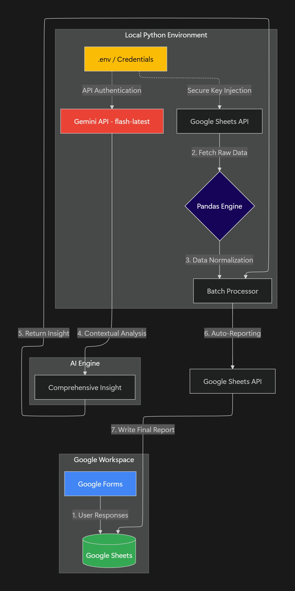

# survey-auto-summarizer

大学の国際交流プログラムのあと、参加者アンケート（Google フォーム）の感想を Gemini で要約し、国籍・性別・参加状況ごとの傾向をレポートにして同じスプレッドシートに書き戻すスクリプトです。
回答は数百件・複数言語で、1件100文字以上あったので、手で読んでまとめるのは大変でした。

A script that reads multilingual survey responses from Google Sheets, summarizes them with Gemini, and writes a report back to the same spreadsheet.

<p align="center"></p>

## What it does

- Reads the form responses from Google Sheets (timestamp, participation status, name, gender, nationality, student ID, feedback).
- Writes a one-line summary for each response into the `AI요약 결과` column. Only rows without a summary are processed, so new responses get summarized on the next run. All pending rows go to Gemini in one call with JSON output.
- Writes an overall report (trends by nationality, gender and participation) to a separate `AI 리포트` tab, replaced on each run.
- Name and student ID are never sent to Gemini.

## Setup

Python 3.11+

```bash
python -m venv venv
venv\Scripts\activate        # macOS/Linux: source venv/bin/activate
pip install -r requirements.txt
```

1. Put the service account key in the project root as `credentials.json`, and share the spreadsheet with the service account's email.
2. Copy `.env.example` to `.env` and set `GEMINI_API_KEY` and `SPREADSHEET_ID` (the part of the sheet URL between `/d/` and `/edit`).
3. Run `python main.py`.

## Problems I ran into

- **404 and 429 from Gemini.** The model name I used had been retired, and calling once per row ran into the free-tier limit. I switched to `gemini-flash-latest` and send all rows in one request.
- **An API key was committed by mistake** and GitHub secret scanning flagged it. I revoked it and moved secrets to `.env`. The old key is still in the history but no longer works ([SECURITY.md](SECURITY.md)).
- **Rows with empty cells had fewer columns** and broke the DataFrame, so rows are padded to the same length first.
- **The report used to be appended under the responses**, and the next run read it back in as survey data. It now goes to its own tab.

Prompt notes: [PROMPT_DESIGN.md](PROMPT_DESIGN.md)

## Ideas for later

- A simple web page so non-developers can run it
- Run automatically on each form submission with Google Apps Script

## Stack

Python · Pandas · Google Sheets API v4 · Gemini (`google-genai`) · python-dotenv
